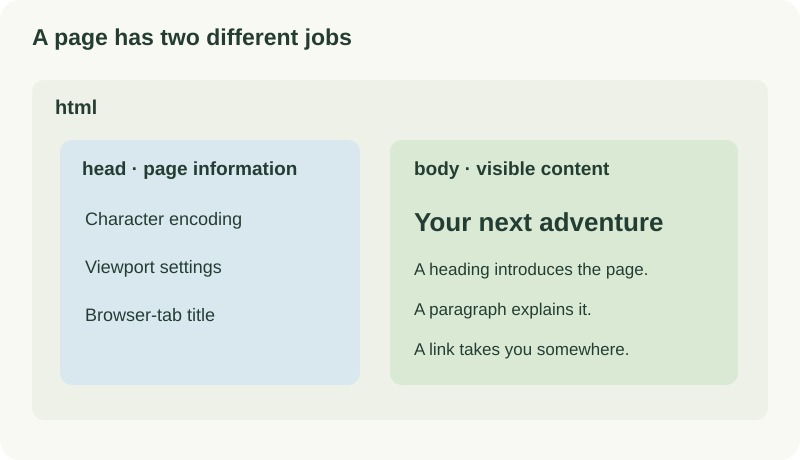
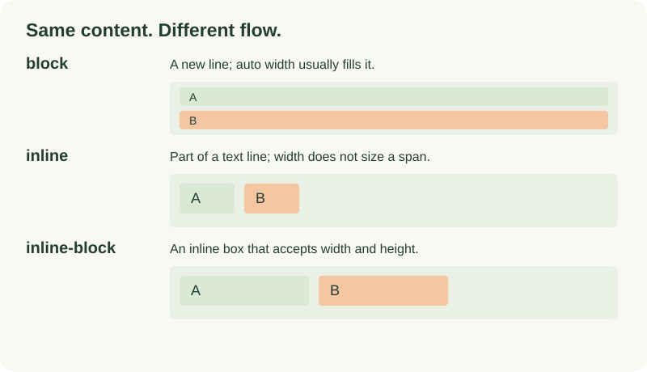
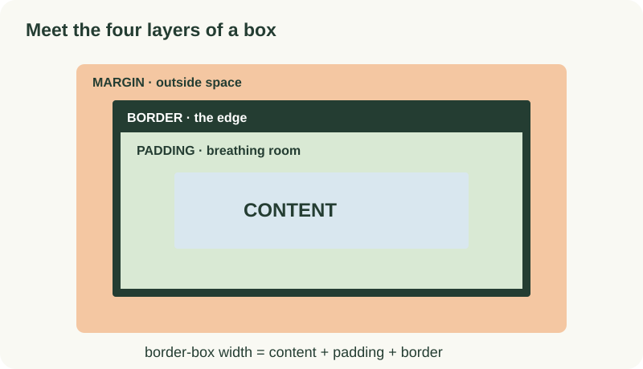
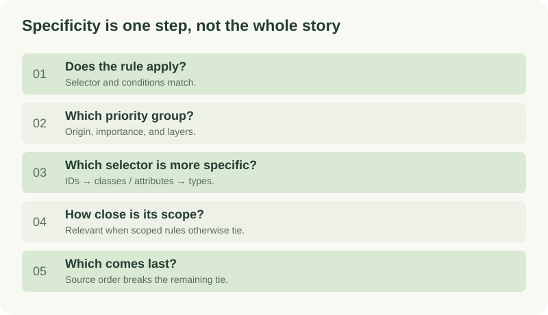
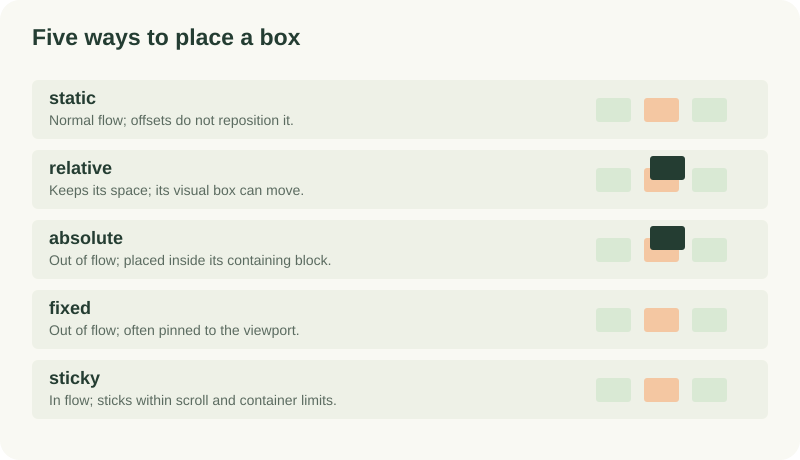
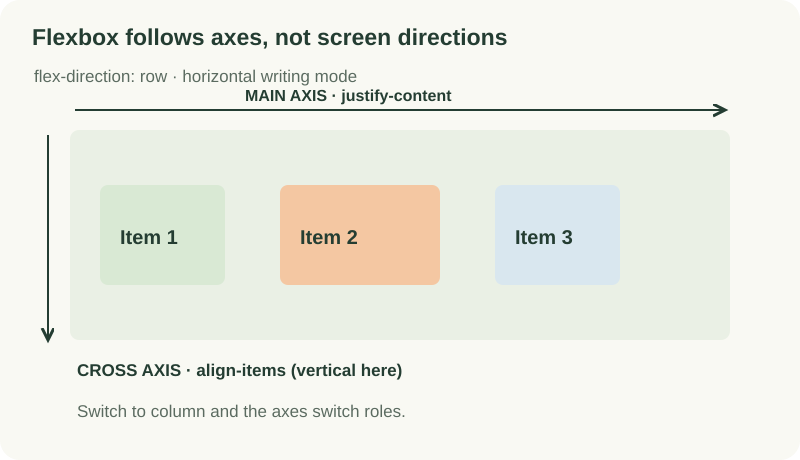
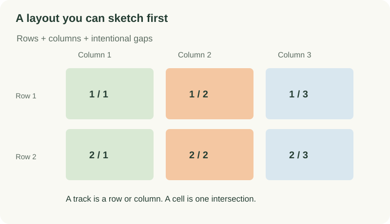
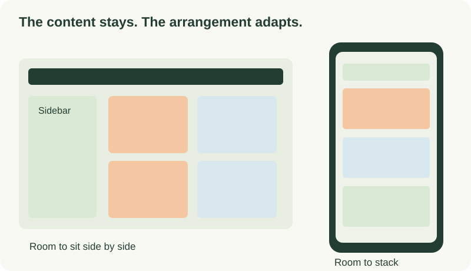
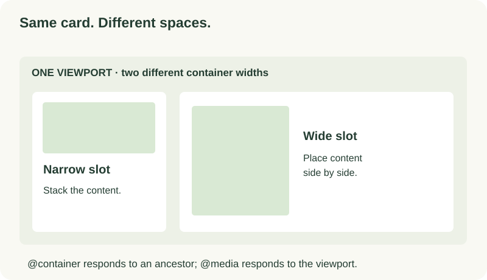
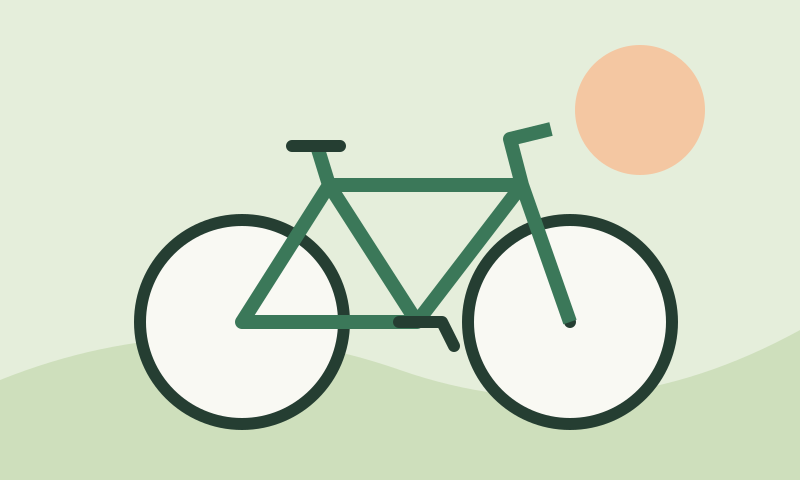

# Fieldnotes — The HTML & CSS Guide

Read → predict → try → explain. Work through one small topic at a time. New means new in this guide, not proof of your prior experience. Added marks foundational material added to the roadmap.

## Table of contents

1. Your first HTML page

2. Everyday content

3. Meaningful page structure

4. Forms people can use

5. Validation without guesswork

6. Accessibility from the start

7. Your first stylesheet

8. Block, inline, inline-block

9. The box model

10. Why one style wins

11. Units and readable text

12. Style a useful card

13. States and smart selectors

14. Normal flow and spacing surprises

15. Positioning and stacking

16. Flexbox: one direction at a time

17. Grid: rows and columns together

18. Let content help choose the size

19. Responsive pages

20. Responsive components

21. Images that fit and load well

22. Themes that stay consistent

23. Motion with a purpose

24. Become your own layout detective

## Chapter 1: Your first HTML page

🆕 New for you · ➕ Added

### 🎯 What is it?

HTML gives content a job: a heading introduces, a paragraph explains, and a link leads somewhere. Tags mark these roles; attributes add details. Think of HTML as a set of meaningful labels attached to your content.

An element usually has an opening tag, content, and a closing tag. Close an inner element before its parent. The head describes the document; the body holds its visible content. The title in the head names the browser tab, while h1 introduces the page itself.

### 🖼️ See it



### 💻 Code example

```html
<!doctype html>
<html lang="en">
  <head>
    <meta charset="utf-8">
    <meta name="viewport" content="width=device-width, initial-scale=1">
    <title>Sunday Cycle Club</title>
  </head>
  <body>
    <!-- Meaning comes before appearance. -->
    <h1>A better way to see the city</h1>
    <p>Bring your <strong>helmet</strong> and your curiosity.</p>
  </body>
</html>
```

### 👀 Output

A large heading sits above a paragraph. “helmet” is usually bold. The browser tab has a different title from the visible heading; the preview below shows only the body.

### 🌍 Real-world use

Every article, booking page, and portfolio starts with a document structure like this.

### Attributes are little settings

In <a href="https://example.com">Visit</a>, href supplies the destination and Visit supplies the label. Quote attribute values and keep them inside the opening tag.

### Why the extra lines?

The doctype requests standards rendering. UTF-8 supports a wide range of characters. The viewport setting helps mobile browsers use the device width; it does not make a fixed-width layout responsive on its own.

### ⚠️ Common mistakes

- Do not cross closing tags: <p><strong>Hi</strong></p> is correctly nested.
- Save as .html, not .html.txt. Save the file before refreshing.
- Void elements such as meta, img, and input have no closing tag or child content.

### ✅ Quick takeaway

HTML describes what the content is, before CSS decides how it looks.

### 🧠 Challenge

Change the tab title to “My first page” and the visible heading to your name. Add a second paragraph. Explain which changes you expect before refreshing.

Where does the browser-tab title belong?

<details><summary>Answer</summary>

Inside <title> in the <head>. The visible page heading belongs in the body.

</details>

What does lang="en" do?

<details><summary>Answer</summary>

It identifies English as the document language, helping tools such as screen readers choose pronunciation.

</details>

### Sources

- [developer.mozilla.org](https://developer.mozilla.org/en-US/docs/Learn_web_development/Core/Structuring_content/Basic_HTML_syntax)
- [developer.mozilla.org](https://developer.mozilla.org/en-US/docs/Learn_web_development/Core/Structuring_content/Webpage_metadata)

## Chapter 2: Everyday content

🆕 New for you · ➕ Added

### 🎯 What is it?

Headings create an outline, paragraphs group ideas, and lists collect related items. Links connect pages. Images need useful alternative text when their content matters.

Choose a heading level by its place in the outline, not its default size. Use an ordered list when the sequence matters and an unordered list when it does not. A relative path starts from the current file location; a full URL includes its destination host.

### 🖼️ See it

A good page remains understandable when you read its headings and links alone.

### 💻 Code example

```html
<h1>Your first city ride</h1>
<p>A slow route with <em>plenty</em> of stops.</p>
<h2>Bring these essentials</h2>
<ul>
  <li>A fitted helmet</li>
  <li>A bottle of water</li>
</ul>
<!-- The link describes its destination. -->
<a href="https://example.com">Read the route guide</a>
```

### 👀 Output

One main heading, a short introduction, a smaller section heading, a bulleted list, and a descriptive link.

### 🌍 Real-world use

Recipe pages, product descriptions, trip guides, and help articles all use this small set of elements.

### A small image example

 expects an images folder next to the HTML file. The dimensions describe the image’s aspect ratio; CSS can still scale it.

### Meaning, not decoration

strong marks importance; em marks stress. Browsers commonly show them as bold and italic, but their meaning matters beyond appearance. Use CSS when you only want a visual change.

### ⚠️ Common mistakes

- Do not use repeated br elements to create page spacing; spacing belongs in CSS.
- Avoid “click here” when a descriptive link label would explain the destination.
- Do not put an image filename in alt text. Describe its purpose; use alt="" for purely decorative images.

### ✅ Quick takeaway

A good page remains understandable when you read its headings and links alone.

### 🧠 Challenge

Write a route guide with one main heading, two sections, a packing list, and three ordered steps. Add a meaningful link.

When would ol be better than ul?

<details><summary>Answer</summary>

For a sequence such as booking steps or assembly instructions.

</details>

How would you show a literal < character in text?

<details><summary>Answer</summary>

Use the character reference &lt;. Use &amp; for an ampersand when it needs escaping.

</details>

### Sources

- [developer.mozilla.org](https://developer.mozilla.org/en-US/docs/Learn_web_development/Core/Structuring_content/Headings_and_paragraphs)
- [developer.mozilla.org](https://developer.mozilla.org/en-US/docs/Learn_web_development/Core/Structuring_content/HTML_images)

## Chapter 3: Meaningful page structure

🆕 New for you

### 🎯 What is it?

Semantic elements tell people and browsers what a region is for. A navigation area is different from an article, even if both happen to look like rectangles. Good HTML gives the page a useful map.

Use main for the central content, nav for significant navigation, and article for a self-contained piece. A section is a themed group, normally with a heading. A div is fine when you only need a styling wrapper.

### 🖼️ See it


### 💻 Code example

```html
<header>
  <p>Sunday Cycle Club</p>
  <nav aria-label="Main">
    <a href="#rides">Rides</a>
    <a href="#contact">Contact</a>
  </nav>
</header>
<main>
  <h1>Find your next ride</h1>
  <section id="rides">
    <h2>This weekend</h2>
    <article>
      <h3>Riverside loop</h3>
      <p>A gentle 12 km ride.</p>
    </article>
  </section>
</main>
<footer id="contact">Meet us at the town square.</footer>
```

### 👀 Output

The content is stacked vertically by default. The navigation links jump to their matching page regions; semantic elements do not automatically create a complex layout.

### 🌍 Real-world use

News articles, dashboards, shop pages, and documentation navigation become easier to understand and navigate.

### ➕ Added · Tables that explain data

Use table with caption for its subject, th scope="col" for column headings, th scope="row" for row headings, and td for values. A rental-price table is appropriate. A layout made from table cells is not.

### Headings form the outline

Use a clear h1, then h2 sections and h3 subsections. A section element does not automatically fix skipped heading levels. aside is for related secondary material.

### ⚠️ Common mistakes

- Do not replace every div with section; use a section for a meaningful topic.
- Use links to navigate and buttons for actions. Styling a div to look clickable does not give it button behavior.
- Keep a single visible main region for the page’s central content.

### ✅ Quick takeaway

Choose the element by its purpose, then style it.

### 🧠 Challenge

Give your route guide a header, labeled navigation, main region, two headed sections, and footer. Check that every internal link has a matching id.

Which element should take someone to a booking page?

<details><summary>Answer</summary>

An anchor with an href, because it navigates.

</details>

Should a data table be used to place the sidebar?

<details><summary>Answer</summary>

No. Tables describe tabular data; CSS layout handles page arrangement.

</details>

### Sources

- [developer.mozilla.org](https://developer.mozilla.org/en-US/docs/Learn_web_development/Core/Structuring_content/Structuring_documents)
- [developer.mozilla.org](https://developer.mozilla.org/en-US/docs/Learn_web_development/Core/Structuring_content/HTML_table_accessibility)

## Chapter 4: Forms people can use

🆕 New for you

### 🎯 What is it?

A form is a conversation: each label asks a question and each control accepts an answer. Good labels stay visible, suitable input types help users enter data, and related controls are grouped together.

A label’s for value must match the control’s id. The id identifies an element; the name is the key used when that control’s data is submitted. fieldset and legend give a group of controls a shared description.

### 🖼️ See it

Labels explain controls; names identify the values you submit.

### 💻 Code example

```html
<form>
  <fieldset>
    <legend>Your rental</legend>
    <p>
      <label for="rider">Full name</label>
      <input id="rider" name="rider" autocomplete="name" required>
    </p>
    <p>
      <label for="email">Email</label>
      <input id="email" name="email" type="email"
        autocomplete="email" required>
    </p>
    <label for="bike">Bike style</label>
    <select id="bike" name="bike">
      <option value="city">City bike</option>
      <option value="touring">Touring bike</option>
    </select>
  </fieldset>
  <button type="submit">Request a bike</button>
</form>
```

### 👀 Output

A grouped rental form with two labeled fields and a dropdown. Clicking “Full name” focuses its input. In the isolated preview, submission is intentionally disabled.

### 🌍 Real-world use

Contact forms, checkout, account settings, and booking flows.

### Choose the control for the task

Use textarea for multiple lines, select for a compact fixed list, checkboxes for independent choices, and radio buttons for one choice in a group. A postal code often belongs in a text field, even if numeric.

### Autofill is a feature

autocomplete="name" and autocomplete="email" help browsers fill known information. inputmode can suggest a keyboard for a text field without changing how its value is interpreted.

### ⚠️ Common mistakes

- A placeholder is not a replacement for a persistent label.
- An id alone does not include a value in submitted form data: give the control a name.
- Specify type="button" for a button that should not submit its containing form.

### ✅ Quick takeaway

Labels explain controls; names identify the values you submit.

### 🧠 Challenge

Add a pickup-date field and a radio group for rental duration. Give the radio buttons one shared name and unique ids. Click every label.

What happens when label for and input id differ?

<details><summary>Answer</summary>

The explicit label-control association fails.

</details>

Does inputmode="numeric" validate a number?

<details><summary>Answer</summary>

No. It suggests a keyboard; it is not a validation rule.

</details>

### Sources

- [developer.mozilla.org](https://developer.mozilla.org/en-US/docs/Web/HTML/Reference/Elements/label)
- [web.dev](https://web.dev/learn/forms/form-fields)

## Chapter 5: Validation without guesswork

🆕 New for you

### 🎯 What is it?

Native validation checks simple rules before the browser submits a form. required means a value is needed; type="email" checks email syntax. These checks help people correct mistakes, but do not replace validation by the receiving service.

The browser checks eligible controls when a normal submission is attempted. A disabled control is not editable and is omitted from submission. A readonly text control cannot be edited but is normally included. Unchecked checkboxes are omitted, rather than sent as false.

### 🖼️ See it

Use browser validation for helpful feedback, not as a security boundary.

### 💻 Code example

```html
<style>
  input:user-invalid { border: 2px solid #a12424; }
  input { padding: .65rem; }
</style>
<form>
  <label for="booking">Booking code (3 uppercase letters)</label>
  <p id="format">For example: ABC. All three letters are required.</p>
  <input id="booking" name="booking" required pattern="[A-Z]{3}"
    aria-describedby="format">
  <button type="submit">Check booking</button>
</form>
```

### 👀 Output

A field with visible format guidance. In a standalone page, an empty or malformed value blocks submission. :user-invalid lets the browser delay invalid styling until relevant interaction; exact timing can vary.

### 🌍 Real-world use

Email entry, quantities, date bounds, and codes with a simple documented format.

### More built-in rules

min and max constrain supported number or date types; step controls allowed increments. minlength and maxlength constrain text length. A pattern matches the whole value and should be paired with readable instructions.

### Submission is a separate step

action chooses a destination and method chooses how data is sent. The receiving service must validate again. This guide’s project uses local demonstration values and sends nothing to an external service.

### ⚠️ Common mistakes

- Do not rely on color alone to explain an error. Keep instructions visible.
- type="email" cannot prove an address exists or belongs to the person.
- novalidate skips interactive form validation; do not add it accidentally.

### ✅ Quick takeaway

Use browser validation for helpful feedback, not as a security boundary.

### 🧠 Challenge

Open the Part 1 project. Submit it empty, then with an invalid email, then valid demo values. Observe the browser’s message and focus behavior.

Will a disabled named input be submitted?

<details><summary>Answer</summary>

No. A supported readonly control normally will be.

</details>

Does an optional empty input fail pattern?

<details><summary>Answer</summary>

Not just because of pattern. Add required when emptiness must be rejected.

</details>

### Sources

- [developer.mozilla.org](https://developer.mozilla.org/en-US/docs/Learn_web_development/Extensions/Forms/Form_validation)
- [developer.mozilla.org](https://developer.mozilla.org/en-US/docs/Web/HTML/Guides/Constraint_validation)

## Chapter 6: Accessibility from the start

🆕 New for you

### 🎯 What is it?

Accessibility means people can use the page with different bodies, devices, and settings. HTML supplies much of the behavior for ordinary controls. An accessible name tells assistive technology what a control is called.

Start with native controls, visible labels, meaningful headings, and sensible document order. ARIA can add meaning, but does not create keyboard behavior. The accessibility tree is a browser representation of useful roles, names, and states—not just a copy of every HTML node.

### 🖼️ See it

Native meaning and predictable keyboard behavior are the best starting point.

### 💻 Code example

```html
<style>
  a:focus-visible, summary:focus-visible {
    outline: 3px solid #17634a;
    outline-offset: 4px;
  }
</style>
<a href="#main-content">Skip to main content</a>
<nav aria-label="Main"><a href="#faq">Rental questions</a></nav>
<main id="main-content" tabindex="-1">
  <h1>Plan your ride</h1>
  <details id="faq">
    <summary>Is a helmet included?</summary>
    <p>Yes. We help you find the right fit.</p>
  </details>
</main>
```

### 👀 Output

A skip link, navigation, and an expandable answer. Tab highlights links and the summary; the native disclosure can be opened with the keyboard.

### 🌍 Real-world use

Every public interface benefits: keyboard users, screen-reader users, and people who zoom or need larger targets.

### Contrast and comfortable targets

WCAG AA generally requires 4.5:1 contrast for ordinary text and 3:1 for large text. Large means at least 18pt, or 14pt bold. Provide roomy controls and do not communicate state through color alone.

### Dialog and inert: understand the boundary

A dialog with the open attribute is non-modal. A true modal needs the browser’s modal-opening behavior; merely styling an overlay is insufficient. inert removes a subtree from interaction and focus. Complex dynamic focus management is outside this HTML/CSS-only course.

### A small manual audit

Check meaningful page titles, image alternatives, labels, focus visibility, reading order, and reflow. WCAG A and AA contain multiple criteria; one automated score cannot establish that a page is accessible.

### ⚠️ Common mistakes

- Never remove focus outlines without a visible replacement.
- Positive tabindex values create a separate focus order that is hard to maintain.
- opacity: 0 does not by itself remove a control from keyboard navigation.

### ✅ Quick takeaway

Native meaning and predictable keyboard behavior are the best starting point.

### 🧠 Challenge

Use only Tab, Shift+Tab, Enter, and Space to explore this example. Then zoom the page. Can you still find the current focus and read everything?

Does role="button" make a div keyboard-operable?

<details><summary>Answer</summary>

No. Use a real button for the built-in behavior.

</details>

What does tabindex="-1" do here?

<details><summary>Answer</summary>

It makes the main region focusable without adding it to normal sequential Tab navigation.

</details>

### Sources

- [www.w3.org](https://www.w3.org/WAI/tutorials/page-structure/)
- [www.w3.org](https://www.w3.org/WAI/ARIA/apg/practices/read-me-first/)

## Chapter 7: Your first stylesheet

🆕 New for you · ➕ Added

### 🎯 What is it?

CSS is a set of rules about appearance. Each rule selects elements and gives them property-value pairs. A class is a reusable label that lets several elements share a style.

The selector .note matches elements whose class list includes note. Properties such as color and font-family commonly inherit from a parent; padding and borders do not. A stylesheet linked from the head lets multiple pages share rules.

### 🖼️ See it

A CSS rule says which elements to style and which properties to change.

### 💻 Code example

```html
<style>
  body { font-family: system-ui, sans-serif; }
  .note {
    color: #18543e;
    background: #e5f1e8;
    padding: 1rem;
    border-radius: .5rem;
  }
</style>
<p class="note">Your helmet is included.</p>
<p>This paragraph keeps its normal background.</p>
```

### 👀 Output

The first paragraph has a pale green background and breathing room. Both paragraphs inherit the body font.

### 🌍 Real-world use

A shared note class can style rental notices, checkout hints, and friendly reminders.

### Read the rule aloud

“.note: use this text color, this background, this inner spacing.” Reading rules this way helps separate selecting the right element from choosing the right value.

### Keep reusable styles together

A style element is handy for learning. An external stylesheet is easier to share. Inline style attributes affect individual elements and can make later overrides harder to follow.

### ⚠️ Common mistakes

- Use a dot for a class selector: .note. The HTML class attribute itself has no dot.
- Properties and values are separated with a colon; declarations end with semicolons.
- Check the stylesheet path before trying stronger selectors when nothing changes.

### ✅ Quick takeaway

A CSS rule says which elements to style and which properties to change.

### 🧠 Challenge

Create styles.css, move the rules into it, and link it from your HTML. Add the note class to a second paragraph.

Does padding automatically pass from a parent to a child?

<details><summary>Answer</summary>

No. Padding is not an inherited property.

</details>

How do you connect a separate stylesheet?

<details><summary>Answer</summary>

Put <link rel="stylesheet" href="styles.css"> in the document head.

</details>

### Sources

- [developer.mozilla.org](https://developer.mozilla.org/en-US/docs/Learn_web_development/Core/Styling_basics/Getting_started)
- [developer.mozilla.org](https://developer.mozilla.org/en-US/docs/Web/CSS/Guides/Cascade/Inheritance)

## Chapter 8: Block, inline, inline-block

🆕 New for you

### 🎯 What is it?

Display controls how a box participates in layout. In ordinary horizontal flow, a block starts on a new line; inline content shares a text line. Inline-block behaves like an inline item whose box can have dimensions.

A normal block with auto width usually fills the available inline space. A non-replaced inline element such as span does not use width and height the same way a block does. Inline-block accepts those dimensions while still sitting among text.

### 🖼️ See it



### 💻 Code example

```html
<style>
  .sample { background: #dbece2; margin: .3rem; padding: .4rem; }
  .block { display: block; }
  .inline { display: inline; }
  .inline-block { display: inline-block; width: 6rem; }
</style>
<span class="sample block">Block A</span>
<span class="sample block">Block B</span>
<p><span class="sample inline">Inline A</span>
  <span class="sample inline">Inline B</span></p>
<span class="sample inline-block">Box A</span>
<span class="sample inline-block">Box B</span>
```

### 👀 Output

Two full-row blocks appear first. Inline labels share a text line. Inline-block labels have a set width and can wrap as whole boxes.

### 🌍 Real-world use

Paragraph flow, badges, labels, and small controls inside text.

### Three ways to hide are different

display: none removes layout participation. visibility: hidden normally keeps space while hiding the content. opacity: 0 makes it transparent but can leave it clickable and keyboard-focusable.

### Outer and inner behavior

display: flex makes a flex formatting context for children; its outer box is block-level by default. Changing the child layout does not mean the container is inline.

### ⚠️ Common mistakes

- Do not expect width: 200px to size an ordinary inline span.
- Vertical padding on inline text can paint beyond the line without separating lines as a block would.
- display changes layout, not an element’s HTML meaning. A block-styled link remains a link.

### ✅ Quick takeaway

Ask whether the element should behave like a line, a word, or an inline box.

### 🧠 Challenge

Change the widths and compare all three rows. Then hide one box with display: none and another with visibility: hidden.

Which option accepts width while sharing a text line?

<details><summary>Answer</summary>

Inline-block.

</details>

Does display: none reserve its former space?

<details><summary>Answer</summary>

No. visibility: hidden normally preserves the box’s layout space.

</details>

### Sources

- [developer.mozilla.org](https://developer.mozilla.org/en-US/docs/Learn_web_development/Core/Styling_basics/Box_model)
- [developer.mozilla.org](https://developer.mozilla.org/en-US/docs/Web/CSS/Reference/Properties/display)

## Chapter 9: The box model

🆕 New for you

### 🎯 What is it?

Every visible element occupies a box. Content sits in the middle, padding cushions it, a border surrounds it, and margin separates it from neighboring boxes. Think of a parcel: item, wrapping, box edge, then the gap on the shelf.

With content-box, width describes only the content. Padding and border add to the outer size. With border-box, the declared width includes content, padding, and border. Margin stays outside either calculation.

### 🖼️ See it



### 💻 Code example

```html
<style>
  .card {
    box-sizing: border-box;
    width: 240px;
    max-width: 100%;
    padding: 20px;
    border: 4px solid #21664d;
    margin: 16px 0;
    background: #e7f2e8;
  }
</style>
<div class="card">This box is 240px wide, including its border.</div>
```

### 👀 Output

A green card is 240px wide when space permits. Its content width is 192px: 240 minus 40px padding and 8px border.

### 🌍 Real-world use

Cards, buttons, form inputs, and any layout where several pieces must fit a known width.

### A useful starting rule

Apply box-sizing: border-box to *, *::before, and *::after for predictable sizing across components. It changes the width calculation; it does not remove spacing.

### Vertical margins have another rule

Some block margins collapse rather than add. We will isolate that behavior in the normal-flow chapter; padding does not collapse.

### ⚠️ Common mistakes

- Margin is never included by border-box.
- A fixed height can clip longer text; prefer padding and natural content height.
- Padding grows the inside of a box; margin separates it from neighbors.

### ✅ Quick takeaway

Use border-box when you want declared widths to include padding and borders.

### 🧠 Challenge

Switch the example to content-box and compare the box width. Then add a long sentence and remove any fixed height.

What is the outer width with content-box, width 240px, padding 20px, and border 4px?

<details><summary>Answer</summary>

288px, before margins: 240 + 40 + 8.

</details>

Does border-box prevent every overflow?

<details><summary>Answer</summary>

No. Long content and minimum sizes can still cause overflow.

</details>

### Sources

- [web.dev](https://web.dev/learn/css/box-model)
- [developer.mozilla.org](https://developer.mozilla.org/en-US/docs/Web/CSS/Reference/Properties/box-sizing)

## Chapter 10: Why one style wins

🆕 New for you

### 🎯 What is it?

The cascade is the browser’s decision process when several declarations target the same property. Specificity is only one step in that process. Imagine a queue with different priority lanes, not a shouting contest.

First check whether a rule applies. Origin, importance, and layer precedence come before selector specificity. For otherwise tied declarations, scoping proximity may matter, then source order decides. In normal author CSS, unlayered rules outrank named-layer rules.

### 🖼️ See it



### 💻 Code example

```html
<style>
  @layer base, components;
  @layer base {
    #welcome { color: firebrick; }
  }
  @layer components {
    .message { color: #17634a; }
  }
</style>
<p id="welcome" class="message">The later normal layer wins.</p>
```

### 👀 Output

The message is green. The later components layer wins before the browser compares the class selector with the ID selector.

### 🌍 Real-world use

A component library, reset, theme, and page stylesheet can coexist without endless !important overrides.

### Specificity is a tuple

Compare ID counts, then class/attribute/pseudo-class counts, then type/pseudo-element counts. It is not a decimal score. :is(), :not(), and :has() use the specificity of their most specific argument.

### The wider picture

Browser styles, user styles, author styles, animations, and transitions occupy defined cascade positions. Inline styles also have special author precedence. The simple “last rule wins” slogan hides those rules.

### ⚠️ Common mistakes

- Do not compare specificity before checking layer precedence.
- A later rule only wins on source order after earlier cascade criteria tie.
- Important declarations reverse named-layer precedence; adding !important can make a layering problem worse.

### ✅ Quick takeaway

Find the winning priority group first, then compare selectors inside it.

### 🧠 Challenge

Move both rules into one layer. Predict the new color before testing. Then remove the ID selector and create a true source-order tie.

Does an ID always beat a class?

<details><summary>Answer</summary>

No. Layer, origin, and importance can decide first.

</details>

What specificity does :where(.card #title) contribute?

<details><summary>Answer</summary>

Zero. :where() and its arguments add no specificity.

</details>

### Sources

- [developer.mozilla.org](https://developer.mozilla.org/en-US/docs/Web/CSS/Guides/Cascade/Introduction)
- [developer.mozilla.org](https://developer.mozilla.org/en-US/docs/Web/CSS/Guides/Cascade/Specificity)

## Chapter 11: Units and readable text

🆕 New for you

### 🎯 What is it?

A size can follow a fixed CSS unit, the root font, the current font, or a containing box. Choosing the relationship is more useful than memorizing a list of units. Text should remain readable when users change their settings.

For font-size, rem relates to the root font and em relates to the parent’s font. On padding, em uses the element’s own font size. Percentage sizing depends on the property and its reference size. A CSS pixel is not necessarily a physical display pixel.

### 🖼️ See it

Pick the relationship you want: root-relative, font-relative, or container-relative.

### 💻 Code example

```html
<style>
  .reading {
    font: 1rem/1.65 system-ui, sans-serif;
    max-width: 60ch;
    padding: 1.5rem;
  }
  .reading h2 { font-size: 1.6rem; line-height: 1.2; }
</style>
<article class="reading">
  <h2>A slower Sunday</h2>
  <p>Take the riverside path. Leave enough time to stop,
    look around, and enjoy the part of the city you usually pass by.</p>
</article>
```

### 👀 Output

Comfortable text spacing and a restrained line length. ch approximates the width of the font’s zero character; it is not an exact character count.

### 🌍 Real-world use

Articles, documentation, form controls, and interfaces that must handle zoom and user font preferences.

### ➕ Added · Text that feels easy

Use a readable font stack, enough line height, and a moderate text width. Align longer paragraphs to the start edge. Avoid all-caps paragraphs and fully justified narrow text.

### Relative does not always mean flexible

A percentage height needs an appropriate reference height. height: 100% often does not fill a parent whose height is auto. We revisit this in the sizing chapter.

### ⚠️ Common mistakes

- Nested em font sizes can multiply; rem is often easier for a shared type scale.
- Do not set a tiny root font just to make rem arithmetic feel easier.
- A line-height without a unit scales cleanly with descendant font sizes.

### ✅ Quick takeaway

Pick the relationship you want: root-relative, font-relative, or container-relative.

### 🧠 Challenge

Increase the browser’s default font setting. Compare a rem-based paragraph with one fixed at 12px. Check both at 200% zoom.

If the root font is 20px, how large is 1.5rem?

<details><summary>Answer</summary>

30 CSS pixels.

</details>

Does px prevent browser zoom?

<details><summary>Answer</summary>

No. Browser zoom also scales CSS-pixel-based content; respecting font preferences is a separate consideration.

</details>

### Sources

- [developer.mozilla.org](https://developer.mozilla.org/en-US/docs/Learn_web_development/Core/Styling_basics/Values_and_units)
- [web.dev](https://web.dev/learn/css/typography)

## Chapter 12: Style a useful card

🆕 New for you · ➕ Added

### 🎯 What is it?

Color, border, background, and shadow help communicate grouping and hierarchy. They work best when each has a job: a border separates, a background groups, and a strong text color preserves readability.

Start with spacing and typography, then add decoration. border-radius rounds corners but does not automatically crop overflowing children. object-fit controls how a replaced image fills a box when that box has a defined size.

### 🖼️ See it

Good styling makes the content’s structure easier to see.

### 💻 Code example

```html
<style>
  .rental {
    max-width: 22rem;
    padding: 1.5rem;
    color: #20392d;
    background: #f0f6ec;
    border: 1px solid #c5d8bf;
    border-radius: 1rem;
    box-shadow: 0 .3rem 1rem rgb(25 50 35 / .08);
    font-family: system-ui, sans-serif;
  }
  .rental p { line-height: 1.6; }
</style>
<article class="rental">
  <p>WEEKEND FAVORITE</p>
  <h2>The city cruiser</h2>
  <p>Comfortable, upright, and ready for the scenic route.</p>
  <a href="https://example.com">View rental details</a>
</article>
```

### 👀 Output

A calm green card with a subtle edge and rounded corners. The text remains the strongest visual element.

### 🌍 Real-world use

Product cards, account panels, pricing options, and helpful notices.

### Images in cards

For a fixed-ratio image box, use width: 100%, aspect-ratio: 4 / 3, and object-fit: cover. For a naturally scaled photo, use max-width: 100% and height: auto.

### A restrained palette

Choose one strong text color, one page background, one surface, and one accent. Check hover, focus, disabled, and error appearances as well as the default state.

### ⚠️ Common mistakes

- Low-contrast muted text can become unreadable; check the actual color pair.
- Do not use a decorative background image for essential information without a text equivalent.
- object-fit: cover can crop important image content; choose an appropriate focal point.

### ✅ Quick takeaway

Good styling makes the content’s structure easier to see.

### 🧠 Challenge

Create two card variants using the same markup. Change only color and border treatments. Keep the spacing and readability consistent.

Does border-radius alone clip a child image?

<details><summary>Answer</summary>

Not necessarily. Set appropriate overflow behavior or round the image itself.

</details>

When is object-fit: contain useful?

<details><summary>Answer</summary>

When the entire image must remain visible inside a sized box, even if empty space remains.

</details>

### Sources

- [web.dev](https://web.dev/learn/css/backgrounds)
- [developer.mozilla.org](https://developer.mozilla.org/en-US/docs/Web/CSS/Reference/Properties/object-fit)

## Chapter 13: States and smart selectors

🆕 New for you

### 🎯 What is it?

Selectors can express relationships and states. A hover state means a pointer is over something; a focus state means it has input focus. Pseudo-elements let you style a generated part of an element.

A space selects descendants, > selects direct children, + selects the next sibling, and ~ selects later siblings. :focus-visible follows browser heuristics for when a focus indicator is useful. :has() can select a parent based on matching descendants.

### 🖼️ See it

Use selectors to express real relationships and user states.

### 💻 Code example

```html
<style>
  .choice {
    display: block;
    padding: 1rem;
    border: 2px solid #c6cec5;
    border-radius: .6rem;
  }
  .choice:has(input:checked) { background: #e5f1e8; border-color: #17634a; }
  input:focus-visible { outline: 3px solid #17634a; outline-offset: 3px; }
</style>
<label class="choice">
  <input type="checkbox" name="helmet"> Include a helmet
</label>
```

### 👀 Output

Check the box to give its whole label a green background and border. Tab to it to see a focus indicator.

### 🌍 Real-world use

Selected cards, focused controls, alternating table rows, and lightweight decoration.

### ➕ Added · Group and filter

:is() groups alternatives. :not() excludes matches. :nth-child() selects by sibling position. ::before and ::after create generated boxes when content is supplied; they are not extra HTML elements.

### Validation states

:invalid can match before the user has had a chance to edit. :user-invalid allows interaction-sensitive feedback. Pair it with real text guidance, not just a red border.

### ⚠️ Common mistakes

- Hover alone is not enough: touch and keyboard users need usable states too.
- Do not put essential instructions only in ::before or ::after generated content.
- A selector can match correctly and still lose in the cascade.

### ✅ Quick takeaway

Use selectors to express real relationships and user states.

### 🧠 Challenge

Add a focus-visible treatment to the Part 2 project. Add a checked option style that is still understandable without color.

What is the difference between .card p and .card > p?

<details><summary>Answer</summary>

The first matches any descendant paragraph; the second only direct children.

</details>

Does :where() increase specificity?

<details><summary>Answer</summary>

No. It is useful for easy-to-override defaults.

</details>

### Sources

- [developer.mozilla.org](https://developer.mozilla.org/en-US/docs/Web/CSS/Reference/Selectors/:has)
- [developer.mozilla.org](https://developer.mozilla.org/en-US/docs/Web/CSS/Reference/Selectors/:focus-visible)

## Chapter 14: Normal flow and spacing surprises

🆕 New for you

### 🎯 What is it?

Normal flow is the browser’s default way of placing content. Before reaching for positioning, understand how ordinary blocks stack. Some neighboring vertical margins collapse into one margin instead of adding together.

Two positive adjoining block margins commonly collapse to the larger value. Parent-child margins can also collapse under specific conditions. Flex and grid item margins do not collapse with each other. flow-root creates a new block formatting context and can contain internal floats.

### 🖼️ See it

Understand ordinary flow before forcing elements out of it.

### 💻 Code example

```html
<style>
  .group {
    display: flow-root;
    background: #edf4e8;
    padding-inline: 1rem;
  }
  .group p { margin-block: 2rem; }
</style>
<section class="group">
  <p>First stop: the riverside.</p>
  <p>Second stop: the old market.</p>
</section>
```

### 👀 Output

The paragraphs’ adjoining positive margins collapse to 2rem, rather than 4rem. flow-root keeps their outer margins from collapsing through the parent; it does not stop sibling margin collapse inside it.

### 🌍 Real-world use

Article spacing, floating illustrations, and debugging unexplained gaps at the top of a section.

### Float still has a useful job

float is useful when text should wrap around an image. clear moves following content past relevant floats. For page columns and component alignment, learn Flexbox and Grid.

### Overflow has side effects

overflow: auto creates scrolling when needed. overflow: hidden clips and creates a scroll container even without visible scrollbars. overflow: clip clips without creating a scroll container.

### ⚠️ Common mistakes

- Do not assume all vertical margins always add.
- overflow: hidden may fix one containment issue while clipping useful content.
- flow-root is not a universal switch that disables every margin collapse.

### ✅ Quick takeaway

Understand ordinary flow before forcing elements out of it.

### 🧠 Challenge

Create two paragraphs with different vertical margins. Then make the parent a flex column and compare. Replace the margins with gap.

Do margins between flex items collapse?

<details><summary>Answer</summary>

No.

</details>

What gap do adjoining positive margins of 16px and 24px usually produce?

<details><summary>Answer</summary>

24px, when the conditions for margin collapse apply.

</details>

### Sources

- [developer.mozilla.org](https://developer.mozilla.org/en-US/docs/Web/CSS/Guides/Box_model/Margin_collapsing)
- [developer.mozilla.org](https://developer.mozilla.org/en-US/docs/Web/CSS/Guides/Display/Block_formatting_context)

## Chapter 15: Positioning and stacking

🆕 New for you

### 🎯 What is it?

Positioning controls whether a box stays in normal flow and what its offsets refer to. Stacking controls which overlapping boxes appear in front. They are related, but a bigger z-index does not always solve an overlap.

Static follows normal flow. Relative keeps its original space while allowing a visual offset. Absolute leaves normal flow and uses a containing block, often the nearest positioned ancestor. Fixed commonly uses the viewport; certain ancestors, including transformed ones, can change that reference. Sticky remains in flow and is constrained by its scroll container and containing block.

### 🖼️ See it



### 💻 Code example

```html
<style>
  .photo {
    position: relative;
    min-height: 10rem;
    padding: 1rem;
    background: #e4ecde;
  }
  .badge {
    position: absolute;
    top: 1rem;
    right: 1rem;
    padding: .4rem .7rem;
    background: #ffd4a9;
  }
</style>
<div class="photo">
  <p>City cruiser</p>
  <span class="badge">Available</span>
</div>
```

### 👀 Output

The badge sits in the top-right corner of the green photo placeholder. It does not reserve a separate row in normal flow.

### 🌍 Real-world use

Card badges, anchored controls, sticky navigation, and carefully designed overlays.

### Debug a sticky element

Check its inset, ancestor overflow, height, containing block, and whether it has room to travel. A short parent can end its sticky movement quickly.

### Contexts are local groups

Positioned elements with a non-auto z-index, transforms, opacity below 1, and other properties can establish contexts. Flex/grid items can also use z-index without being positioned. Browser top-layer content sits outside ordinary stacking contexts.

### ⚠️ Common mistakes

- Absolute positioning needs a deliberate containing block.
- Sticky usually needs an inset such as top: 0 and enough scrolling room.
- A child cannot use z-index to escape its parent’s lower stacking context.

### ✅ Quick takeaway

First identify the containing block; then identify the stacking context.

### 🧠 Challenge

Add a relative offset to the card title. Compare it with absolute positioning. Build a sticky header in a page tall enough to scroll.

Does relative positioning remove the original space?

<details><summary>Answer</summary>

No. Its original layout space remains.

</details>

Why can z-index: 9999 lose to z-index: 1?

<details><summary>Answer</summary>

They may belong to different stacking contexts, with the entire first context below the second.

</details>

### Sources

- [developer.mozilla.org](https://developer.mozilla.org/en-US/docs/Web/CSS/Reference/Properties/position)
- [developer.mozilla.org](https://developer.mozilla.org/en-US/docs/Web/CSS/Guides/Positioned_layout/Stacking_context)

## Chapter 16: Flexbox: one direction at a time

🆕 New for you

### 🎯 What is it?

Flexbox arranges items along a main axis and helps distribute available space. The cross axis runs perpendicular to it. Imagine arranging books on one shelf, then deciding their spacing and alignment.

flex-direction chooses the main axis. justify-content distributes main-axis space; align-items aligns items on the cross axis. With row in a horizontal writing mode, main is horizontal. With column, those roles switch. gap separates items without needing edge margins.

### 🖼️ See it



### 💻 Code example

```html
<style>
  .ride {
    display: flex;
    align-items: center;
    gap: 1rem;
    padding: 1rem;
    background: #e8f1e3;
  }
  .description { flex: 1 1 0; min-width: 0; }
  .description p { overflow-wrap: anywhere; }
  .price { flex-shrink: 0; }
</style>
<article class="ride">
  <div class="description">
    <h2>Riverside tour</h2>
    <p>A beautifully-long-route-name-that-still-needs-to-fit</p>
  </div>
  <strong class="price">₹250</strong>
</article>
```

### 👀 Output

The text takes the flexible space; the price keeps its width. The description can shrink, and the long text can wrap rather than pushing the price outside.

### 🌍 Real-world use

Navigation bars, button groups, media objects, and rows with a flexible description and fixed action.

### Grow, shrink, basis

flex: 1 1 12rem means grow factor 1, shrink factor 1, starting basis 12rem. Positive space is distributed using grow factors; shrinking also depends on base sizes. Min/max constraints can stop that negotiation.

### Wrapping is optional

The default is nowrap. Set flex-wrap: wrap when items should move onto new lines. Each line distributes its own space, so wrapped Flexbox does not promise aligned columns across rows.

### ⚠️ Common mistakes

- Do not memorize “justify is horizontal”: it follows the main axis.
- flex-shrink: 1 does not automatically defeat an item’s automatic minimum size.
- Visual reordering does not reliably change keyboard or reading order. Keep the HTML order meaningful.

### ✅ Quick takeaway

Flexbox negotiates space along an axis; minimum sizes still set boundaries.

### 🧠 Challenge

Remove min-width: 0 and overflow-wrap. Narrow the preview and observe the failure. Restore one rule at a time and explain each job.

What often lets a row flex item shrink below its content-based minimum?

<details><summary>Answer</summary>

min-width: 0 on the relevant item, plus a deliberate strategy for overflowing content.

</details>

What does align-content affect?

<details><summary>Answer</summary>

The distribution of flex lines when a wrapping flex container has extra cross-axis space—not alignment within a single line.

</details>

### Sources

- [web.dev](https://web.dev/learn/css/flexbox)
- [developer.mozilla.org](https://developer.mozilla.org/en-US/docs/Web/CSS/Reference/Properties/flex)

## Chapter 17: Grid: rows and columns together

🆕 New for you

### 🎯 What is it?

Grid arranges content across rows and columns at the same time. You define tracks, then place items or let the browser place them. It is a helpful way to draw a page’s layout before filling in details.

A track is a row or column; a cell is one intersection. fr distributes a share of remaining space. Grid items have minimum-size behavior too, so minmax(0, 1fr) can be more shrinkable than a bare 1fr track.

### 🖼️ See it



### 💻 Code example

```html
<style>
  .cards {
    display: grid;
    grid-template-columns: repeat(auto-fit, minmax(min(100%, 12rem), 1fr));
    gap: 1rem;
  }
  .cards article { padding: 1.5rem; background: #e8f1e3; min-width: 0; }
</style>
<div class="cards">
  <article>City cruiser</article>
  <article>Touring bike</article>
  <article>Weekend tandem</article>
</div>
```

### 👀 Output

Cards form as many columns as fit. Each tries to be at least 12rem, but can become narrower when the container itself is smaller.

### 🌍 Real-world use

Product listings, dashboards, galleries, and aligned page regions.

### Named areas sketch the page

grid-template-areas: "header header" "sidebar main" "footer footer" pairs naturally with grid-area on each child. Start with a single-column version for a narrow viewport.

### Use both layout systems

A dashboard can use Grid for the shell and Flexbox inside each card. Choose the system for the relationship you need, not as a permanent preference.

### ⚠️ Common mistakes

- Three 33.33% tracks plus gaps can overflow; use fractions or account for gaps.
- Making a track shrinkable does not automatically wrap a long unbreakable string inside it.
- Named grid areas must form rectangles.

### ✅ Quick takeaway

Use Grid when relationships between rows and columns matter.

### 🧠 Challenge

Create a page with named header, sidebar, main, and footer areas. Then change the card example from auto-fit to auto-fill and compare a wide view with only two items.

How do auto-fit and auto-fill differ with unused columns?

<details><summary>Answer</summary>

auto-fill retains empty repeated tracks; auto-fit collapses the empty tracks so occupied ones can expand.

</details>

Does subgrid create an independent set of parent-aligned track sizes?

<details><summary>Answer</summary>

It adopts the parent grid’s tracks in the chosen axis, allowing descendants to align with them.

</details>

### Sources

- [web.dev](https://web.dev/learn/css/grid)
- [developer.mozilla.org](https://developer.mozilla.org/en-US/docs/Web/CSS/Guides/Grid_layout/Subgrid)

## Chapter 18: Let content help choose the size

🆕 New for you

### 🎯 What is it?

Intrinsic sizing starts with the content’s own size needs. min-content asks how narrow content can become at its available breaks; max-content asks how wide it wants to be without soft wrapping. fit-content balances those limits with available space.

A long unbreakable word raises the minimum content size. An automatic flex or grid minimum can therefore prevent a box from shrinking. Logical properties describe start/end and inline/block directions so layouts can adapt to different writing modes.

### 🖼️ See it

Separate the box’s allowed size from the content’s overflow behavior.

### 💻 Code example

```html
<style>
  .panel {
    inline-size: fit-content;
    max-inline-size: 100%;
    padding-inline: 1rem;
    padding-block: .8rem;
    border: 1px solid #9db59c;
    overflow-wrap: anywhere;
    box-sizing: border-box;
  }
</style>
<div class="panel">Pickup: Old Town Market</div>
```

### 👀 Output

The panel hugs the short label when there is room and is constrained by its container when space becomes tight.

### 🌍 Real-world use

Badges, shrinkable sidebar content, variable labels, and multilingual interfaces.

### The height question

In ordinary flow, percentage height often acts like auto when the containing block’s height is content-dependent. Flex and grid have additional definite-size rules. Give the layout a clear sizing relationship instead of stacking height: 100% guesses.

### Direction-aware spacing

inline-size and block-size describe the writing axes. padding-inline, margin-block, and border-inline-start work with those axes. Direction-aware properties are especially useful for right-to-left content.

### ⚠️ Common mistakes

- width: 100% plus padding can overflow under content-box.
- height: 100% needs an appropriate reference size; an auto-height parent is not a promise to fill the viewport.
- min-width: 0 removes a lower bound but does not decide whether content should wrap, scroll, or clip.

### ✅ Quick takeaway

Separate the box’s allowed size from the content’s overflow behavior.

### 🧠 Challenge

Put a long URL in a narrow card. Compare overflow-wrap: anywhere, a scrollable wrapper, and clipping. Explain which preserves the information best for that UI.

Why does a very long URL break an otherwise flexible layout?

<details><summary>Answer</summary>

It can establish a large unbreakable minimum width.

</details>

What replaces margin-left for the inline start edge?

<details><summary>Answer</summary>

margin-inline-start. Its physical side depends on writing direction and writing mode.

</details>

### Sources

- [developer.mozilla.org](https://developer.mozilla.org/en-US/docs/Web/CSS/Reference/Values/min-content)
- [developer.mozilla.org](https://developer.mozilla.org/en-US/docs/Web/CSS/Guides/Logical_properties_and_values)

## Chapter 19: Responsive pages

🆕 New for you

### 🎯 What is it?

A responsive page adapts to available space and user settings. Start with a layout that works when space is limited, then add roomier arrangements where the content benefits. Breakpoints are decisions about the design, not a list of device names.

A media query checks the viewport or another media feature. Fluid values vary continuously between bounds. clamp(minimum, preferred, maximum) is useful for headings and spacing when both small and large extremes need limits.

### 🖼️ See it



### 💻 Code example

```html
<style>
  .intro { padding: clamp(1rem, 4vw, 3rem); }
  .intro h1 { font-size: clamp(1.8rem, 1.1rem + 3vw, 3rem); }
  .layout { display: grid; gap: 1rem; }
  .layout > div { padding: 1rem; background: #e8f1e3; }
  @media (min-width: 40rem) {
    .layout { grid-template-columns: 2fr 1fr; }
  }
</style>
<section class="intro">
  <h1>Make space for the scenic route.</h1>
  <div class="layout"><div>Ride details</div><div>Booking summary</div></div>
</section>
```

### 👀 Output

The sections stack in a narrow viewport and sit side by side above 40rem. The heading changes gradually within its bounds.

### 🌍 Real-world use

Every page that needs to work on phones, large monitors, and zoomed browsers.

### Reflow matters

At high zoom, ordinary content should reflow without page-wide two-dimensional scrolling. Some content such as genuinely two-dimensional data tables has exceptions; contain its scroll area rather than widening the whole page.

### Touch and viewport units

Give interactive controls generous targets and spacing. min-height: 100svh can avoid an oversized initial screen under mobile browser controls; 100dvh tracks changing usable height and may resize during scrolling.

### ⚠️ Common mistakes

- Do not disable zoom in the viewport metadata.
- A media query should solve a visible layout need, not match a phone brand.
- Using only viewport units for font size can undermine user text-size preferences.

### ✅ Quick takeaway

Let the content tell you when the layout needs to change.

### 🧠 Challenge

Drag the browser from wide to narrow slowly. Fix the first point where the content becomes uncomfortable. Check text zoom and a narrow viewport, not only preset device sizes.

Does a narrow desktop window need a mobile-friendly layout?

<details><summary>Answer</summary>

Yes. Available space matters more than the device label.

</details>

What does dvh follow?

<details><summary>Answer</summary>

The dynamic viewport height; svh uses the small viewport height and is more stable as browser controls change.

</details>

### Sources

- [web.dev](https://web.dev/learn/design/media-queries)
- [developer.mozilla.org](https://developer.mozilla.org/en-US/docs/Web/CSS/Reference/Values/clamp)

## Chapter 20: Responsive components

🆕 New for you

### 🎯 What is it?

A container query responds to a component’s available space rather than the whole viewport. The same card can be narrow in a sidebar and wide in the main content. It should adapt to the place it actually occupies.

Declare an ancestor as a query container with container-type: inline-size. Descendant styles inside a size query depend on a matching ancestor container. A component does not query its own size to style itself through that same size query.

### 🖼️ See it



### 💻 Code example

```html
<style>
  .slot { container-type: inline-size; }
  .card { display: grid; gap: 1rem; padding: 1rem; background: #e8f1e3; }
  .art { min-height: 5rem; background: #c2d9b7; }
  @container (min-width: 24rem) {
    .card { grid-template-columns: 1fr 2fr; align-items: center; }
  }
</style>
<div class="slot">
  <article class="card">
    <div class="art" aria-hidden="true"></div>
    <div><h2>City cruiser</h2><p>Built for the slow lane.</p></div>
  </article>
</div>
```

### 👀 Output

The card stacks until its containing slot is at least 24rem wide. A wide page alone does not guarantee a side-by-side card.

### 🌍 Real-world use

Reusable product cards, search results, dashboard widgets, and sidebar callouts.

### Named containers

container-name can identify a particular ancestor when nested containers make the default choice unclear. A named @container query asks for that matching ancestor.

### Container units

cqi follows inline size and cqb follows block size. Use clamp() when fluid type needs bounds. A suitable container is part of the component’s layout contract.

### ⚠️ Common mistakes

- Put containment on an ancestor of the element you want to restyle.
- Containment changes sizing behavior; do not add it to every element indiscriminately.
- Use viewport media queries for page-wide decisions and container queries for local ones.

### ✅ Quick takeaway

A component should respond to the space its parent gives it.

### 🧠 Challenge

Place the same card in a narrow sidebar and a wide content area. Keep their markup and CSS identical and compare their layouts.

Can two identical cards look different in one viewport?

<details><summary>Answer</summary>

Yes. They can have containers with different sizes.

</details>

What is 1cqi?

<details><summary>Answer</summary>

One percent of the relevant query container’s inline size. Make the intended container explicit.

</details>

### Sources

- [developer.mozilla.org](https://developer.mozilla.org/en-US/docs/Web/CSS/Guides/Containment/Container_queries)
- [developer.mozilla.org](https://developer.mozilla.org/en-US/docs/Web/CSS/Guides/Containment/Container_size_and_style_queries)

## Chapter 21: Images that fit and load well

🆕 New for you

### 🎯 What is it?

Responsive images have two jobs: fit their layout box and let the browser choose an appropriate file. CSS handles the visible size. HTML can provide candidate files and describe how much space the image will occupy.

With width-descriptor srcset, each candidate names its real intrinsic pixel width. sizes estimates the rendered slot width in CSS pixels. The browser combines that hint with device pixel density and other conditions. picture selects sources for art direction or format support.

### 🖼️ See it

Describe the image’s space honestly and let the browser choose the file.

### 💻 Code example

```html
<style>
  img { display: block; max-width: 100%; height: auto; }
</style>
<!-- This local SVG scales without losing sharpness. -->

```

### 👀 Output

A local bicycle illustration fits inside the preview while preserving its aspect ratio. The width and height also let the browser reserve the right shape before the image loads.

### 🌍 Real-world use

Hero photos, product thumbnails, galleries, and editorial images.

### A raster-image recipe

 assumes those files exist and that the stated slot widths match the layout.

### Formats and cropping

Inside picture, list AVIF and WebP sources with their types before the fallback img. The img still carries alt and dimensions. Provide the actual files; changing a filename extension does not convert an image.

### ⚠️ Common mistakes

- A false sizes value can make the browser choose an unnecessarily large or small file.
- width and height attributes do not prevent CSS from resizing the image.
- Do not lazy-load the main above-the-fold image when it is important to initial rendering.

### ✅ Quick takeaway

Describe the image’s space honestly and let the browser choose the file.

### 🧠 Challenge

Use your own photo exported at 480 and 960 pixels wide. Supply both candidates and an accurate sizes value, then inspect which file loads at different viewport sizes and densities.

Does a 400px-wide slot always need a 400-pixel file?

<details><summary>Answer</summary>

No. A high-density display may benefit from more image pixels.

</details>

What is picture useful for beyond resolution?

<details><summary>Answer</summary>

Different crops or compositions at different widths, and supported-format alternatives.

</details>

### Sources

- [web.dev](https://web.dev/learn/design/responsive-images)
- [developer.mozilla.org](https://developer.mozilla.org/en-US/docs/Web/HTML/Guides/Responsive_images)

## Chapter 22: Themes that stay consistent

🆕 New for you

### 🎯 What is it?

Custom properties store reusable CSS values. A semantic name such as --surface describes a purpose, so you can change a theme without rewriting every component. The same idea keeps spacing and typography consistent.

Define defaults at the root, then override tokens in a theme scope or preference query. var() reads the value and can provide a fallback. Custom properties normally inherit, so a themed section can supply values to its descendants.

### 🖼️ See it

Name values by their job so the design can change coherently.

### 💻 Code example

```html
<style>
  :root { --surface: #edf4e7; --ink: #233f2e; --space: 1.5rem; }
  .panel { background: var(--surface); color: var(--ink); padding: var(--space); }
  @media (prefers-color-scheme: dark) {
    :root { --surface: #21392d; --ink: #edf4e7; }
  }
</style>
<section class="panel">
  <h2>Your ride, your pace.</h2>
  <p>This panel follows the device’s color-scheme preference.</p>
</section>
```

### 👀 Output

A light green panel in a light system theme, or a dark green panel with light text in a dark system theme.

### 🌍 Real-world use

Design systems, dark mode, branded sections, and consistent component families.

### Organize without a fight

A layer order such as reset, base, components, utilities makes normal overrides predictable. Keep the unlayered escape hatch deliberate. Important declarations reverse layer ordering.

### A useful token ladder

A primitive might name a green shade, a semantic token might call it --action, and a component token might use it for a button. Avoid creating three layers of names before the project actually needs them.

### ⚠️ Common mistakes

- Changing only the background can leave text or controls unreadable.
- A custom property is still subject to the cascade.
- Do not assume a palette is accessible in every state; check actual combinations.

### ✅ Quick takeaway

Name values by their job so the design can change coherently.

### 🧠 Challenge

Replace hardcoded card colors with --surface, --text, and --border. Create a nested alternate-theme section and verify its links and focus styles.

Will a child normally inherit --surface?

<details><summary>Answer</summary>

Yes, ordinary custom properties inherit unless their registration changes that behavior.

</details>

Does a CSS custom property escape cascade rules?

<details><summary>Answer</summary>

No. Its declarations participate in the cascade.

</details>

### Sources

- [developer.mozilla.org](https://developer.mozilla.org/en-US/docs/Web/CSS/Guides/Cascading_variables/Using_custom_properties)
- [developer.mozilla.org](https://developer.mozilla.org/en-US/docs/Web/CSS/Reference/At-rules/@media/prefers-color-scheme)

## Chapter 23: Motion with a purpose

🆕 New for you · ➕ Added

### 🎯 What is it?

A transition softens a change between states. A keyframe animation describes a sequence. Good motion helps a user follow what changed and respects people who prefer less movement.

Animating size or position through layout properties can require repeated layout work. Transform and opacity often avoid layout, but they are not a guarantee of free rendering. Use modest effects and honor prefers-reduced-motion.

### 🖼️ See it

Animate a useful change, keep it small, and respect reduced motion.

### 💻 Code example

```html
<style>
  .ride-link {
    display: inline-block;
    padding: 1rem;
    color: white;
    background: #1d6148;
    transition: transform 180ms ease;
  }
  .ride-link:hover { transform: translateY(-3px); }
  .ride-link:focus-visible { outline: 3px solid #b65b1b; outline-offset: 4px; }
  @media (prefers-reduced-motion: reduce) {
    .ride-link { transition: none; }
    .ride-link:hover { transform: none; }
  }
</style>
<a class="ride-link" href="https://example.com">Explore a ride</a>
```

### 👀 Output

The link lifts gently on hover, unless reduced motion is preferred. Keyboard focus remains visible without requiring the hover effect.

### 🌍 Real-world use

State changes, expanding panels, and lightweight feedback that supports rather than distracts from a task.

### A browser’s visual pipeline

Style chooses the rules, layout calculates geometry, paint draws visual content, and compositing combines layers. A change may invalidate more than one stage. Avoid blanket claims that every transform is automatically GPU-accelerated.

### Long pages

content-visibility: auto can let the browser skip some offscreen rendering. Pair it with appropriate intrinsic size estimates when using it; test scrolling, find-in-page, and accessibility behavior. It is an optimization, not a substitute for sound layout.

### ⚠️ Common mistakes

- Do not use transition: all when only one property should animate.
- Avoid endless motion and important information that appears only during an animation.
- Do not scatter will-change everywhere; extra compositing resources have a cost.

### ✅ Quick takeaway

Animate a useful change, keep it small, and respect reduced motion.

### 🧠 Challenge

Test the example with reduced motion enabled. Add a short keyframe effect only if it improves feedback, and give it the same reduced-motion treatment.

Does transform change the box’s normal-flow footprint?

<details><summary>Answer</summary>

No. It changes its visual rendering without moving surrounding flow content in the same way.

</details>

What is a keyframe animation?

<details><summary>Answer</summary>

A named sequence of property values assigned through animation; unlike a transition, it can define multiple stages.

</details>

### Sources

- [web.dev](https://web.dev/learn/css/transitions)
- [web.dev](https://web.dev/learn/css/animations)
- [developer.mozilla.org](https://developer.mozilla.org/en-US/docs/Web/CSS/Reference/At-rules/@media/prefers-reduced-motion)

## Chapter 24: Become your own layout detective

🆕 New for you

### 🎯 What is it?

Debugging CSS is asking which rule explains the result you see. Reduce the problem to one box, inspect its computed styles, and test one hypothesis at a time. A small reproducible example teaches more than a pile of overrides.

Start with the HTML relationship, then the cascade, then layout constraints. Identify the container, available space, minimum sizes, and overflow strategy. A fix should explain why the original behavior occurred.

### 🖼️ See it

Find the smallest example that explains the bug, then fix the cause.

### 💻 Code example

```html
<style>
  .dashboard { display: grid; grid-template-columns: minmax(0, 1fr); }
  .table-wrap { overflow-x: auto; }
  table { border-collapse: collapse; min-width: 28rem; width: 100%; }
  th, td { padding: .8rem; border: 1px solid #a7bda4; text-align: start; }
</style>
<div class="dashboard">
  <div class="table-wrap" tabindex="0" role="region" aria-label="Rental prices">
    <table>
      <caption>Daily rental prices</caption>
      <thead><tr><th scope="col">Bike</th><th scope="col">Price</th></tr></thead>
      <tbody><tr><th scope="row">City cruiser</th><td>₹250</td></tr></tbody>
    </table>
  </div>
</div>
```

### 👀 Output

On a narrow viewport, the table scrolls inside its own named region instead of forcing the entire page wider. The table keeps its row and column meaning.

### 🌍 Real-world use

Production bug reports: narrow screens, translated labels, longer data, and unexpected zoom levels.

### Your investigation order

1. Does the selector match? 2. Which declaration wins? 3. Which formatting context applies? 4. What limits the size? 5. Where should excess content go? 6. Does the fix survive another viewport and longer text?

### A final accessibility pass

Check heading order, labels, keyboard focus, contrast, reduced motion, image alternatives, and reflow. Keep tabular data scrollable when its two-dimensional relationship is essential. Test the complete interaction, not only the screenshot.

### ⚠️ Common mistakes

- Do not hide page-wide overflow just to conceal the symptom.
- Do not change five properties at once and lose track of the cause.
- A screenshot at one width does not prove the layout is responsive.

### ✅ Quick takeaway

Find the smallest example that explains the bug, then fix the cause.

### 🧠 Challenge

Reproduce five bugs: a long word overflow, a stubborn flex item, a grid blowout, a trapped z-index, and a collapsed margin. Write one sentence explaining each before fixing it.

A rule is crossed out in the style inspector. What should you inspect?

<details><summary>Answer</summary>

The winning declaration and why it wins: relevance, cascade priority, specificity, and order.

</details>

What should a good layout bug report include?

<details><summary>Answer</summary>

The viewport and settings, expected versus actual behavior, minimal markup/styles, and the rule causing the result.

</details>

### Sources

- [developer.mozilla.org](https://developer.mozilla.org/en-US/docs/Learn_web_development/Core/Styling_basics/Debugging_CSS)
- [www.w3.org](https://www.w3.org/WAI/WCAG22/Understanding/reflow.html)

## Three mini projects

### A booking page with good manners

Meaningful structure, visible labels, and native validation. Start with the browser’s own helpful behaviors.

- Create a header, main region, and footer.
- Give every control a persistent label and a useful name.
- Group the rental options and use suitable input types.
- Test required fields and navigate using only your keyboard.

[Working example](projects/booking.html)

### A rental card worth reading

Turn plain content into a warm, readable component. Give spacing, color, and focus a clear purpose.

- Create a card with an image, heading, description, and navigation link.
- Use border-box and flexible width constraints.
- Use an image alternative and a visible keyboard focus style.
- Style a labeled contact field without depending on placeholder text.

[Working example](projects/rental-card.html)

### Your first responsive dashboard

Bring the pieces together: Grid for the page, Flexbox for small rows, and container queries for reusable cards.

- Build a sticky header and a sidebar with real section links.
- Make the layout stack when the content needs more room.
- Use a container query inside each rental card.
- Contain the table’s horizontal scrolling and test keyboard access.
- Follow system dark mode and respect user font settings.

[Working example](projects/dashboard.html)

## Final revision checklist

### HTML & meaning

- [ ] I can explain head versus body and title versus h1.
- [ ] I choose links for navigation and buttons for actions.
- [ ] My headings and page regions form a useful outline.
- [ ] Every form control has a persistent label and a name when needed.
- [ ] I understand native validation and its limits.
- [ ] My images have meaningful alternatives or empty alt when decorative.

### CSS & appearance

- [ ] I can calculate a box’s width under both box-sizing models.
- [ ] I can explain which declaration wins without guessing.
- [ ] I choose units based on their reference size.
- [ ] Text stays readable with zoom and larger font preferences.
- [ ] Focus and error states do not depend on color alone.

### Layout & adaptability

- [ ] I can identify a containing block and a stacking context.
- [ ] I can explain Flexbox axes and automatic minimum sizes.
- [ ] I can build a Grid with intentional tracks and gaps.
- [ ] Long text and tables do not force unwanted page overflow.
- [ ] I can choose between media and container queries.
- [ ] My image size hints match the actual layout.
- [ ] I test keyboard use, contrast, reflow, and reduced motion.
- [ ] I can write a one-sentence root cause for a layout bug.